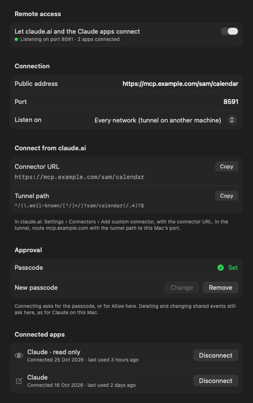
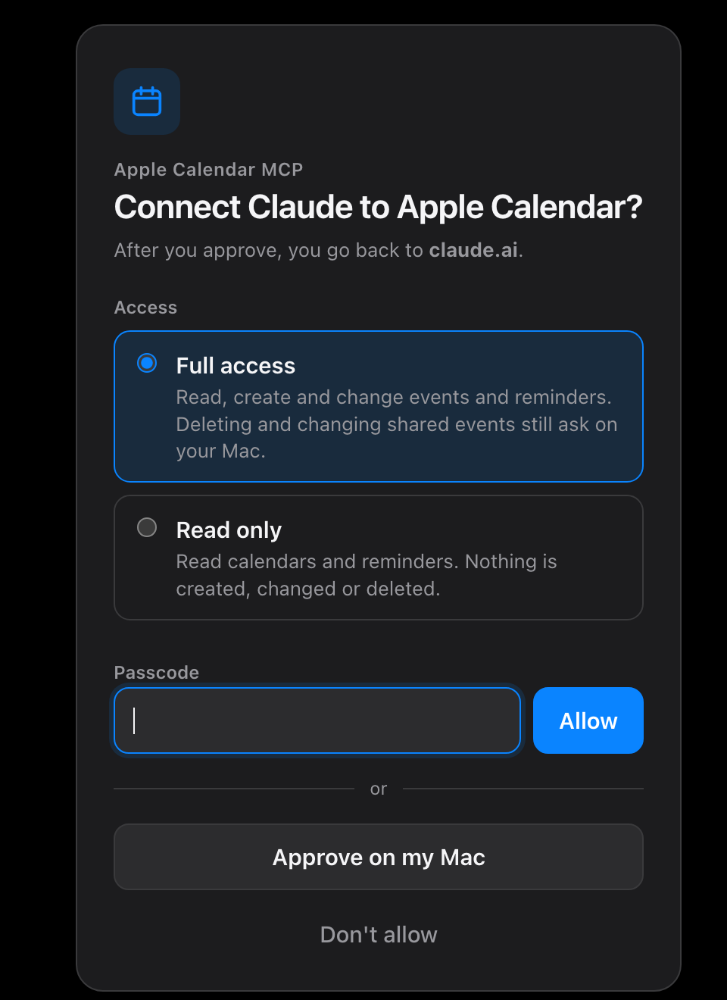
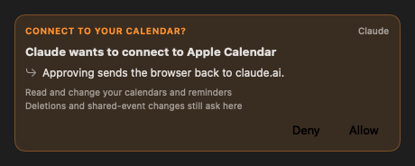

<p align="center">
  
</p>

<h1 align="center">Apple Calendar MCP</h1>

<p align="center">
  Let Claude read, search and plan your Apple Calendar: fast, local, and nothing deleted or sent to other people without your OK.
</p>

<p align="center">
  <a href="https://github.com/mp-consulting/apple-calendar-mcp/releases/latest"></a>
  <a href="https://github.com/mp-consulting/apple-calendar-mcp/actions/workflows/ci.yml"></a>
  
  
  <a href="LICENSE"></a>
  <a href="https://mcpservers.org/servers/mp-consulting/apple-calendar-mcp"></a>
</p>

Apple Calendar MCP is an [MCP](https://modelcontextprotocol.io) server for the Calendar app on your Mac, plus a
small menu bar app. Claude (Claude Code, the Claude app, or any MCP client) can see your day, search years of
events, find free time across all your calendars, plan focus blocks, prepare meetings, and add or move events,
and it can only delete an event, or change one other people are invited to, after you click **OK**.

The companion of [Apple Mail MCP](https://github.com/mp-consulting/apple-mail-mcp), built the same way.

<p align="center">
  <picture><source media="(prefers-color-scheme: light)" srcset="docs/images/tab-calendar-light.png"></picture>
  <picture><source media="(prefers-color-scheme: light)" srcset="docs/images/tab-claude-light.png"></picture>
  <picture><source media="(prefers-color-scheme: light)" srcset="docs/images/tab-settings-light.png"></picture>
</p>

## Any calendar account, ready for AI

Apple Calendar MCP works with **every calendar you can add to Calendar**: iCloud, Google, Microsoft 365 and
Exchange, Yahoo, Fastmail, any CalDAV server, subscribed calendars (holidays, sports, team schedules), birthdays,
and calendars on your Mac only.

Your provider needs no API, no developer account and no MCP support of its own. Add the account in Calendar ›
Settings › Accounts as you normally would; as soon as Calendar syncs it, every tool works with it, side by side
with the others. Your passwords stay with macOS: this app never sees them and never connects to your provider.

## Why another Calendar server?

Most Calendar servers drive Calendar with AppleScript. Calendar then walks its events one by one, so a search over
a busy year takes seconds or times out, repeating events come back wrong, and Calendar is busy meanwhile.

Apple Calendar MCP uses **EventKit**, the framework Calendar itself is built on. Reads are database queries that
return in milliseconds, repeating events expand exactly as Calendar shows them, and Calendar never has to run.

- **Fast**: a day, a week or a year of events in milliseconds, from every account at once.
- **Free time that knows your week**: working hours, buffers between meetings, all-day and declined events
  handled the way Calendar shows them.
- **Safe by default**: deleting asks first, changes to events other people are invited to ask first, every change
  can be undone, and each calendar is yours to set: Claude may change it, only read it, or never see it.
- **Many changes, one OK**: a week of focus blocks or a rescheduled afternoon is one call, one approval and one
  undo.
- **Reminders too**: with Reminders access, Claude lists, adds and ticks off reminders, and the agenda shows what
  is due.
- **One permission** (two with Reminders): given once to the menu bar app. No Full Disk Access, no Automation.
- **No passwords, no cloud**: everything stays on your Mac.

## Install

**Homebrew:**

```sh
brew install --cask mp-consulting/tap/apple-calendar-mcp
```

**Or download** the app or the Claude extension from the [latest release](https://github.com/mp-consulting/apple-calendar-mcp/releases/latest):

| File | For |
|---|---|
| `AppleCalendarMCP-x.y.z.dmg` | The menu bar app with the server inside: Calendar access, approvals, activity, skills, one-click setup. Required. |
| `AppleCalendarMCP-x.y.z.mcpb` | The Claude app only: double-click to install the server as a Claude extension. It still needs the app above for Calendar access. |

Both are notarized, signed with Developer ID, and run on Apple silicon and Intel Macs (macOS 14+). The server is also
listed in the [MCP registry](https://registry.modelcontextprotocol.io) as `io.github.mp-consulting/apple-calendar-mcp`.

Then:

1. Open **Apple Calendar MCP**: a calendar appears in the menu bar.
2. Click **Allow Calendar Access** and choose **Allow Full Access** in the macOS prompt.
3. Open the **Claude** tab and click **Connect** next to Claude Code and/or the Claude app.

### Permissions

macOS gives calendar access to the app that starts a process. Claude, a terminal or an editor starts the server,
and none of them can be given Calendar access on its behalf. So the **menu bar app holds the Calendars
permission**, and servers reach your calendars through it, over a socket in your owner-only support folder. Each
side checks the other's code signature: the app answers only this project's server, and the server talks only to
this project's app. If the app is not running, the server opens it in the background.

| Permission | Why | Where |
|---|---|---|
| **Calendars › Full Access** for Apple Calendar MCP | Read and change events | Asked once by the app; System Settings › Privacy & Security › Calendars |
| **Reminders › Full Access** (optional) | Read, add and complete reminders | Asked when you turn Reminders on in the app's Settings tab; System Settings › Privacy & Security › Reminders |

## claude.ai and your phone

The Claude apps on iPhone, Android and the web reach Calendar on your Mac as a **custom connector**. The menu bar
app serves MCP over HTTP with OAuth; a tunnel (such as cloudflared) publishes it at an HTTPS address of yours.
Turn it on in **More settings… › Remote access**:

<p align="center">
  <picture><source media="(prefers-color-scheme: light)" srcset="docs/images/settings-remote-light.png"></picture>
</p>

1. Enter the **public address** the tunnel publishes, such as `https://mcp.example.com/me/calendar`. Several
   servers can share one host name, each on its own path (Apple Mail MCP at `/me/mail`, for instance).
2. Route that path to the port (8591 by default) in the tunnel. The route must also carry the discovery documents,
   which OAuth puts at the root with the path appended; the settings show the exact path pattern, for example
   `^/(\.well-known/[^/]+/)?me/calendar(/.*)?$`.
3. Set a **passcode** to approve connections from anywhere, or approve them in the menu bar app.
4. In claude.ai, **Settings › Connectors › Add custom connector** with the connector URL (no client ID or secret).
   **Connect** opens the sign-in page:

<p align="center">
  <picture><source media="(prefers-color-scheme: light)" srcset="docs/images/signin-light.png"></picture>
  <picture><source media="(prefers-color-scheme: light)" srcset="docs/images/approval-connect-light.png"></picture>
</p>

A connection may do what Claude on the Mac may do, or only read; deleting and changing shared events still wait for
your OK in the menu bar app. **Connected apps** lists each one, and **Disconnect** ends it at its next request.
Tokens last an hour and refresh for 90 days of use; the server keeps only their hashes. Details, the tunnel set-up
and the security model: [docs/remote.md](docs/remote.md).

## What Claude can do

| Tool | What it does |
|---|---|
| `agenda` | Today (or the next days) in one call: what's now and next, conflicts, free time left, open invitations, reminders due |
| `list_events` | Events in a period, from all calendars or some, repeating ones expanded |
| `search_events` | Text, person, place, calendar, dates, video calls, status; or counts per calendar, month, weekday or person with `group_by` |
| `get_event` | One event in full: notes, attendees and their answers, alarms, repeat rule, video link |
| `find_free_time` | Slots of a given length within your working hours, with buffers, across every calendar that counts; within someone else's working hours in their time zone too; as text to paste in a message |
| `find_conflicts` | Overlapping events that both take the time |
| `find_duplicates` | Events entered twice, which copy to keep, and which copies can safely go |
| `pending_invitations` | Invitations you haven't answered |
| `respond_to_invitation` | Accept, decline or answer "maybe" to an invitation; Calendar sends the answer to the organizer |
| `calendar_statistics` | Where time went: per calendar, weekday, hour and person, meeting load, back-to-back meetings |
| `list_calendars` | Calendars with their account, colour and whether they can be changed |
| `create_event`, `update_event`, `delete_event` | Add, change, move or delete events, one occurrence or the whole series, with alarms and repeat rules |
| `create_events`, `update_events` | Many events in one call, checked before any change, one approval and one undo for all of them |
| `list_reminders`, `create_reminder`, `update_reminder`, `delete_reminders` | Reminders: what's open or overdue, add one with a due day or time, tick it off, move it to another list |
| `undo_change` | Lists recent changes and puts one back |
| `import_ics`, `export_events` | Add events from an `.ics` file (an invitation saved from Mail), or write events to `.ics`, CSV or JSON: free/busy only, or as an invitation to attach to an email |
| `open_in_calendar` | Show an event or a day in Calendar |

Event ids are EventKit's own; one occurrence of a repeating event is `<id>#<start in Unix seconds>`.

EventKit cannot invite people from Calendar. Invite them in Calendar, or by email: `export_events` with `invite`
writes a standard invitation they can accept or decline, and the `calendar-invite-by-mail` skill attaches it to a
draft in Mail (with [Apple Mail MCP](https://github.com/mp-consulting/apple-mail-mcp)). Invitations to you can be answered with
`respond_to_invitation`, which uses the same (undocumented) EventKit call as Calendar; the account sends the answer
to the organizer, and the app asks you first.

## You stay in control

<p align="center">
  <picture><source media="(prefers-color-scheme: light)" srcset="docs/images/approval-light.png"></picture>
</p>

When Claude wants to delete events, or change an event other people are invited to, a small window pops up with
what would change; nothing happens without a click on **OK**.

- **Delete policy** (Settings): *Ask me first* (the default), *Delete right away*, or *Never delete*.
- **Shared events**: changes to events with other attendees ask first by default, because their calendar server
  may tell them.
- **Undo**: every change can be put back with `undo_change`, a whole batch with one id. A deleted event comes back
  without its attendees (EventKit cannot invite them again).
- **Each calendar and reminder list** (Settings): *Read and change*, *Read only* (Claude never adds, moves,
  changes or deletes anything there), or *Hidden* (never read, listed or changed).
- **Batch limits**: at most 50 events per change by default.
- **Read-only mode**: `apple-calendar-mcp --read-only` offers only the reading tools.
- **Activity**: every tool call is listed in the menu bar app (never with event details).

## Skills

Pick them in the panel's **Claude** tab: each one shows what it does and whether it's installed.

| Skill | Or just ask… |
|---|---|
| `/calendar-daily-brief` | "What does my day look like?" |
| `/calendar-scheduler` | "Find an hour with no meetings next week for the budget review." |
| `/calendar-focus-time` | "Block six hours of focus time this week, mornings if possible." |
| `/calendar-meeting-prep` | "Prepare me for my meetings tomorrow." |
| `/calendar-weekly-review` | "How did my week go, and what does next week look like?" |
| `/calendar-time-audit` | "Where did my time go this month?" |
| `/calendar-cleanup` | "Find duplicates and conflicts in my calendar and clean them up." |
| `/calendar-invite-import` | "Add this flight confirmation to my calendar." |
| `/calendar-invite-by-mail` | "Invite Sam and Priya to Thursday's planning session." |

The skills are also served as MCP prompts (in Claude Code: `/mcp__apple-calendar__calendar-daily-brief` and so
on), and two resources, `calendar://today` and `calendar://upcoming`, notify subscribed clients when the day changes.

## Command line

```text
apple-calendar-mcp [--read-only]                                        serve MCP over stdio
apple-calendar-mcp remote [--port N] [--listen ADDR] [--address URL]    serve MCP over HTTP with OAuth (claude.ai)
apple-calendar-mcp doctor                                               check the app, the permission and the bridge
apple-calendar-mcp install | uninstall [claude-code | claude-desktop]   register with Claude
apple-calendar-mcp skills [list | install | uninstall | export DIR]     manage the Claude skills
apple-calendar-mcp call <tool> '{"json": "arguments"}'                  run one tool
```

## How it works

```text
claude.ai ──HTTPS──▶ tunnel ──HTTP──▶ apple-calendar-mcp remote (OAuth, run by the app) ──▶ EventKit; approvals over the socket
Claude ──MCP (stdio)──▶ apple-calendar-mcp ──socket (signatures checked)──▶ Apple Calendar MCP.app ──▶ EventKit ──▶ your accounts
                                                                            menu bar: approvals · activity · settings · Claude setup · updates
```

- **CalendarStore**: the event model, EventKit, the bridge, repeat rules, free time, conflicts, statistics and
  iCalendar files.
- **CalendarMCPKit**: the tools, policies, approvals, undo and skills; **CalendarMCPBar** is the SwiftUI menu bar
  app (Liquid Glass on macOS 26).

## Development

```sh
git clone https://github.com/mp-consulting/apple-calendar-mcp && cd apple-calendar-mcp
# Files under ~/Documents carry Finder metadata that codesign rejects: build outside the repo.
swift test --scratch-path ~/Library/Caches/apple-calendar-mcp-build   # tests run on in-memory calendars
Scripts/build-app.sh --install                                        # build, sign, install, launch the app
```

`apple-calendar-mcp --demo` serves a made-up week from memory, to try the tools without touching your calendars.
The screenshots come from the app's `--demo --approval 3 --snapshot DIR`.

Tests never touch your calendars: they run on `MemoryBackend`, which follows EventKit's rules for repeating
events and read-only calendars. Requires Xcode 26 (Swift 6.2) for the app; the server builds with Swift 6.1.

## License

[MIT](LICENSE) © 2026 Mickael Palma. Not affiliated with Apple. Apple Calendar is a trademark of Apple Inc.
